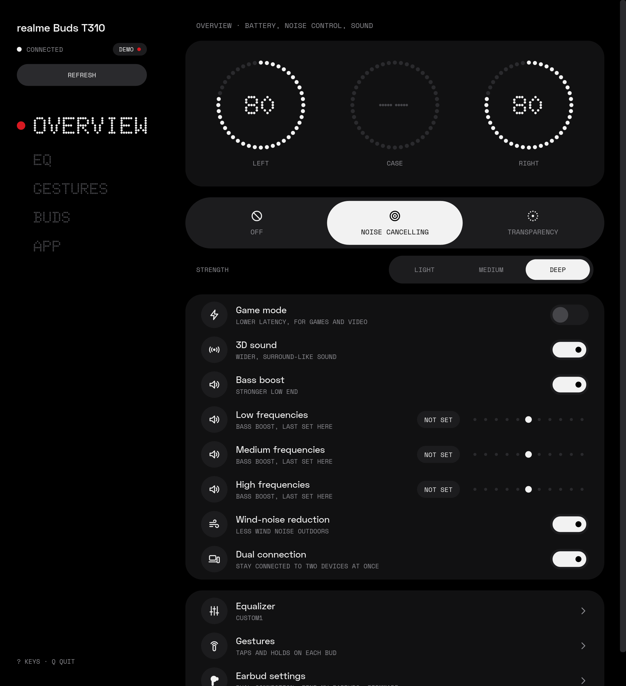
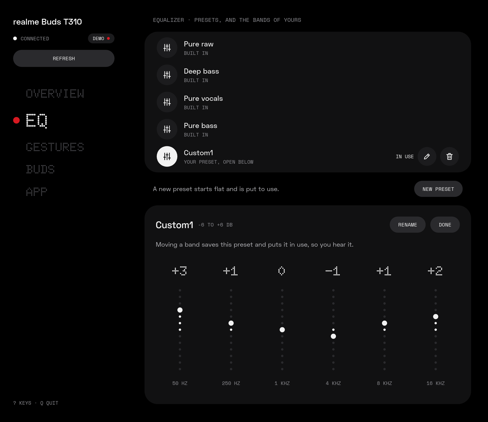
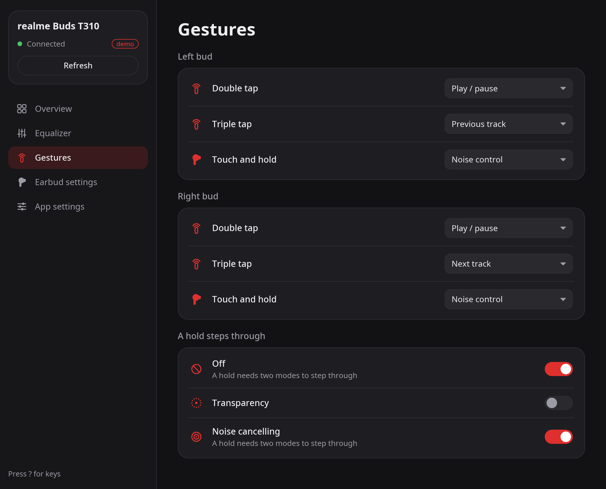
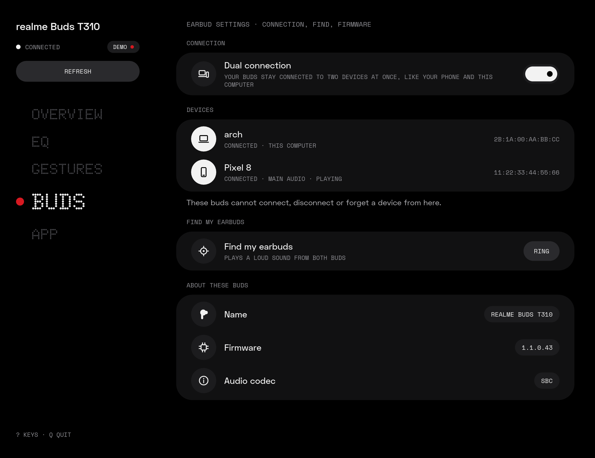
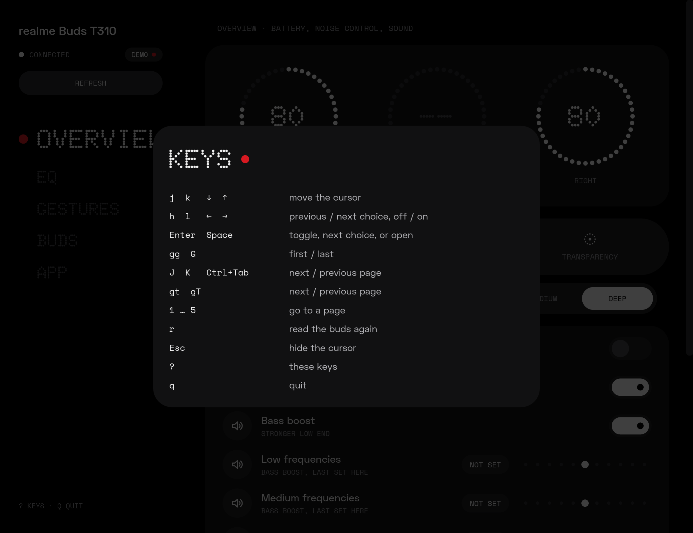
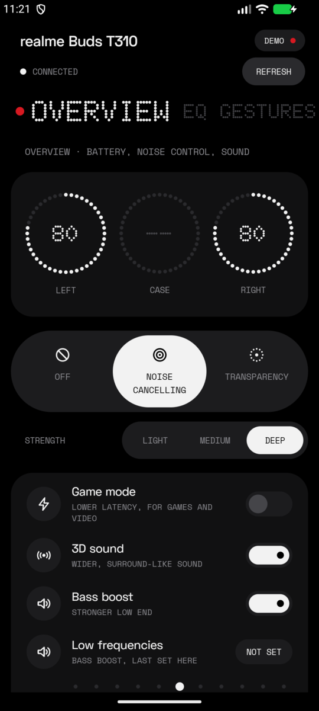
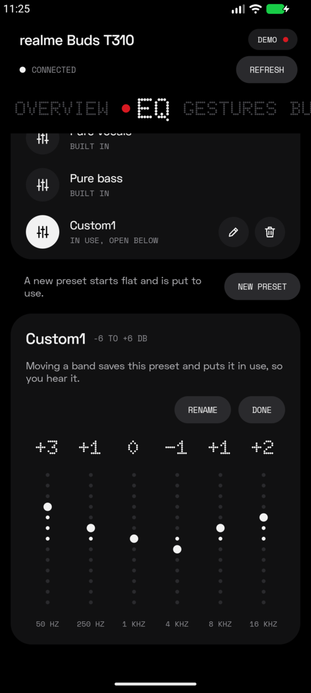
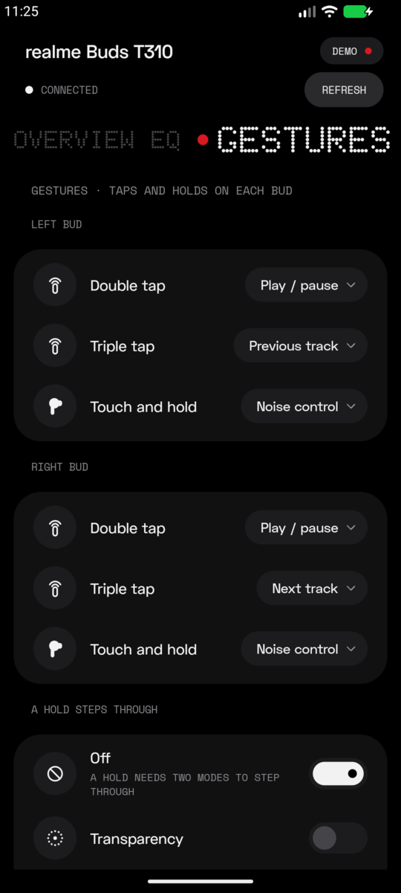

<div align="center">
  
  <p>Control your wireless earbuds from Linux and Android, without the vendor app.</p>
</div>

Noise control, EQ, game mode, touch controls, battery and more. There is a command-line tool,
`budctl`, a desktop app, `budctl-gui`, and an [Android app](#android-app), all built on the same
library.

- No telemetry and no account. budctl talks to your buds over Bluetooth, through BlueZ on Linux.
  The Android app does not even have the internet permission.
- The settings live on the buds, so a change made on one device shows on the others.

**Supported buds:** realme Buds T310. More are added as the author gets them.

<p align="center">
  
</p>

## Install

You need Linux with BlueZ, and for the desktop app a Wayland desktop. Release builds are for
x86_64 and aarch64 (glibc 2.35 or newer).

```sh
curl -fsSL https://github.com/krolyxon/budctl/releases/latest/download/install.sh | sh
```

This puts `budctl` and `budctl-gui` in `~/.local/bin`, and a launcher entry and its icon in
`~/.local/share`. The download is checked against its SHA-256 checksum. Options:

```sh
sh install.sh --version 0.1.1        # a given release instead of the latest
sh install.sh --prefix /usr/local    # elsewhere (uses sudo when it must)
sh install.sh --uninstall            # remove them again; your config and log stay
```

To build from source instead (Rust 1.88 or newer), run `./install.sh --source` in a checkout.

On Arch, `contrib/arch/PKGBUILD` packages the release builds: run `makepkg -si` in that directory.

Pair the buds and connect them in your Bluetooth settings first.

## Command line

```sh
budctl list                                # paired buds, and whether budctl knows them
budctl status                              # battery, noise control, EQ, switches
budctl anc off|on|transparency             # noise control
budctl anc light|medium|deep               # noise cancelling, at this strength
budctl eq                                  # the EQ presets, and the one in use
budctl eq deep-bass                        # select a preset
budctl eq custom-4 50=+3 16000=-2          # change bands of a custom preset (dB)
budctl eq new Gym                          # create a custom preset: flat, and put to use
budctl eq rename custom-4 "Gym mix"        # rename a custom preset
budctl eq delete custom-4                  # delete a custom preset
budctl game on|off                         # game mode (low latency)
budctl set bass-boost|spatial|wind|dual on|off
budctl dual                                # the phones and computers dual connection keeps
budctl bass low 2                          # bass boost, band by band (low, medium, high): -5 to +5
budctl touch                               # what each tap and hold does
budctl touch left triple-tap previous      # give a gesture an action (--dry-run first, if you like)
budctl touch cycle off anc                 # the modes a hold steps through
budctl find start --yes                    # ring the buds (loud: take them out of your ears)
budctl find stop
```

- `--json` prints machine-readable output for scripts and status bars (`"schema": 1`).
- `--debug` hex-dumps every frame sent and received, on stderr.
- `--device <MAC>` picks the buds when more than one supported pair is connected. Without it,
  `"device"` in the config file (below) is used, if set.

Exit codes:

| Code | Meaning |
|---|---|
| 0 | success |
| 1 | usage error |
| 2 | buds not found or not connected |
| 3 | control channel busy |
| 4 | the buds rejected the command or did not answer |

## Desktop app

`budctl-gui` has five pages:

- **Overview:** battery, noise control and its strength, the switches, the bass level.
- **Equalizer:** the presets; create, rename and delete your own, and change their bands.
- **Gestures:** what each tap and hold does on each bud, and what a hold steps through.
- **Earbud settings:** dual connection and the devices it keeps, find my earbuds, firmware, audio codec.
- **App settings:** where the colors come from, the keys, the version.

<table>
  <tr>
    <td valign="top"></td>
    <td valign="top"></td>
  </tr>
  <tr>
    <td valign="top"></td>
    <td valign="top"></td>
  </tr>
</table>

The screenshots show `--demo`'s made-up buds.

The app connects when it needs to, and frees the buds' control channel 10 s after your last
change, so other apps can use it. A change shows "Saving…" until the buds confirm it.

The mouse works everywhere. Vim-like keys work on top of it (press `?` in the window):

| Keys | What they do |
|---|---|
| `j` `k`, arrows, Tab | move the cursor |
| `gg` `G` | first / last item |
| `h` `l` | previous / next choice, switch off / on; `l` opens a row's page |
| Enter, Space | toggle, step through the choices, or open |
| `J` `K`, Ctrl+Tab, `gt` `gT` | next / previous page |
| `1` … `5` | go to a page |
| `r` | read the buds again |
| Esc | hide the cursor |
| `q` | quit |

The cursor shows only after you press a key, and the first key only shows it.

**Look:** Nothing OS shapes and type in Material You colors: dot-matrix page names and battery
figures, LED rings and dotted sliders, pill switches and tracks. The fonts (Doto, Space Grotesk,
Space Mono) are built into the app.

**Colors:** a built-in palette (near-black, white "on" states, red for live things such as the open
page's dot and "Saving…"), or a [matugen](https://github.com/InioX/matugen) palette: `--theme
<file>`, else `~/.config/budctl/theme.json`. The file is JSON with Material 3 roles, `on_x` spelled
`xFg`, all optional: `primary`, `primaryFg`, `primaryContainer`, `primaryContainerFg`, `tertiary`,
`tertiaryFg`, `surfaceLowest`, `surfaceLow`, `surfaceHigh`, `surfaceHighest`, `surfaceFg`,
`surfaceVariantFg`, `outline`, `outlineVariant`, `err`, `errFg` (`bg` and `fg` still work for
`surfaceLowest` and `surfaceFg`; other keys are ignored). A matugen template only needs lines like
`"primary": "{{colors.primary.default.hex}}"`. The file is read again whenever the window gets
focus, so a new wallpaper's colors show up there too. When the file is missing, the app writes the
built-in colors there: a starting point for a template.

**Log:** each launch writes errors and session events (connected, each change and its answer,
closed) to `~/.local/state/budctl/gui.log`, replacing the last launch's.

Other options: `--demo` shows made-up buds without Bluetooth; `--debug` and `--device` work as in
the command-line tool.

## Android app

`android/` holds an Android app (Android 12 or newer) with the desktop app's pages and look, on a
phone: the same Rust library runs inside it, and only the Bluetooth link and the screen are Kotlin.
Its colors come from your wallpaper (Material You), or from the desktop app's near-black palette.

<p align="center">
  
  
  
</p>

The app talks to the buds only while it is on screen, and frees their control channel 10 s after
your last change or when you leave it, so your computer can use it. It has no internet permission,
and its build fails if anything adds one. A switch on its App page turns on the debug log, which you
can copy from there.

To install it, download `budctl.apk` from the
[latest release](https://github.com/krolyxon/budctl/releases/latest) on your phone and open it
(Android asks you to allow installs from your browser or file manager). New versions come out as
new releases: an app such as Obtainium can watch them for you, since budctl itself never checks.
The APK is signed with budctl's own key. Its certificate's SHA-256 fingerprint is
`45:6F:9B:93:AA:40:1D:57:AA:6C:75:0D:FF:13:FA:82:5A:7B:28:B6:3D:D0:40:99:80:6F:A9:7C:14:75:23:12`.

To build it yourself instead and put it on your phone (with USB debugging on), you need Android
Studio or the Android SDK with its NDK, the Rust targets
(`rustup target add aarch64-linux-android x86_64-linux-android`) and `cargo install cargo-ndk`:

```sh
cd android
./gradlew installDebug
```

A build of your own is signed with your machine's debug key, so Android will not install a release
over it, or the other way round: uninstall one before installing the other.

How it is put together: [`docs/android.md`](docs/android.md). The screenshots show made-up buds
(`adb shell am start -n io.github.krolyxon.budctl/.MainActivity --ez demo true`).

## Config

`~/.config/budctl/config.json` is created with the defaults the first time it is needed. Every key
is optional; a file with a mistake is reported and the defaults are used.

```json
{
  "device": null,
  "gui": {
    "idle_seconds": 10,
    "start_page": "overview",
    "motion": true
  }
}
```

- `device`: the buds to use when `--device` is not given, as `"AA:BB:CC:DD:EE:FF"`.
- `gui.idle_seconds`: how long the app keeps the control channel open after the last change
  (1–600).
- `gui.start_page`: `overview`, `equalizer`, `gestures`, `earbuds` or `settings`.
- `gui.motion`: `false` turns the app's animations off; every change then shows at once.

## How it works

budctl speaks the buds' own control protocol over an RFCOMM socket. What is known about it, and
how sure, is written down in [`docs/protocol/`](docs/protocol/): the
[transport](docs/protocol/transport.md) and the [realme Buds T310](docs/protocol/realme_t310.md).

## License

GPL-3.0-or-later. See [LICENSE](LICENSE).

The desktop and Android apps carry the Doto, Space Grotesk and Space Mono fonts, under the SIL
Open Font License 1.1 ([`crates/budctl-gui/fonts/OFL.txt`](crates/budctl-gui/fonts/OFL.txt)). The
Doto in them is a static instance (rounded dots, black weight, Latin only), renamed "Doto Rounded"
as the license asks of modified fonts.
