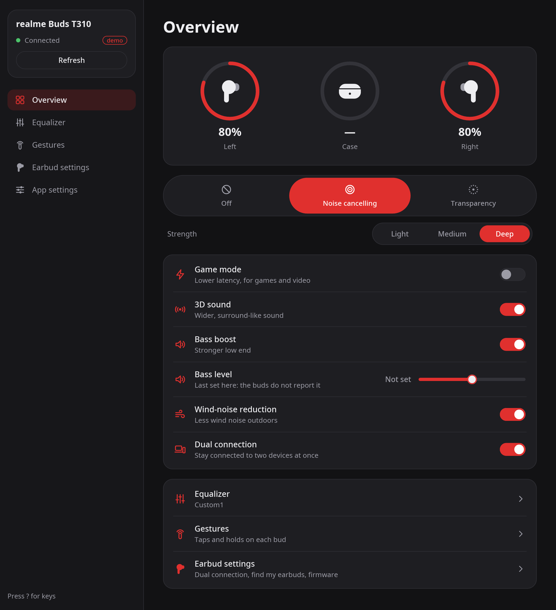
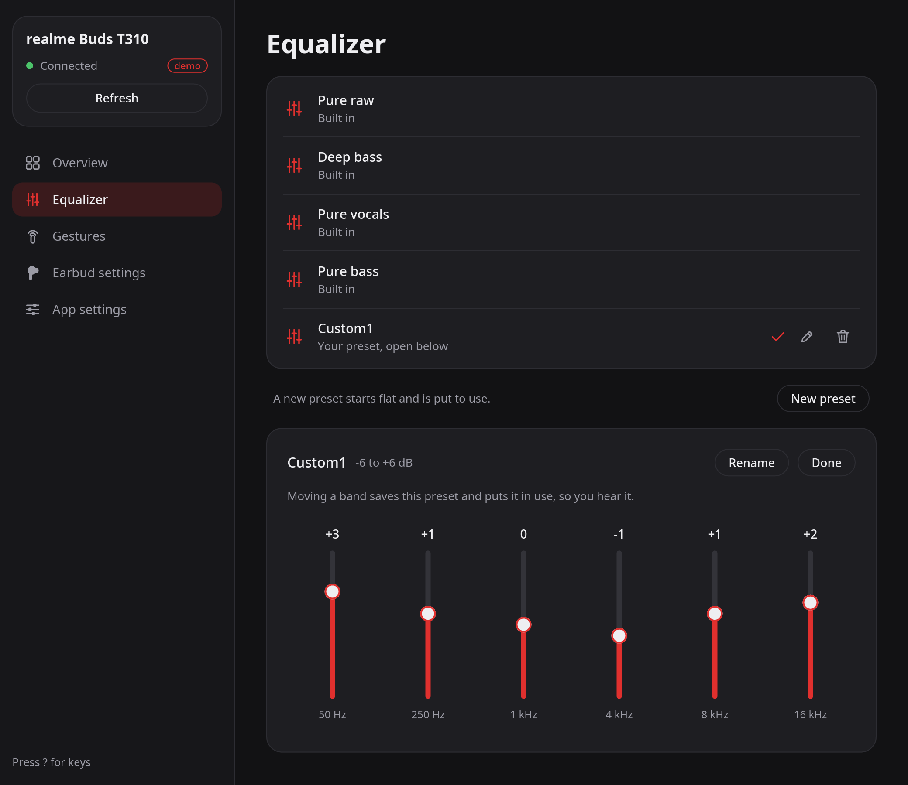
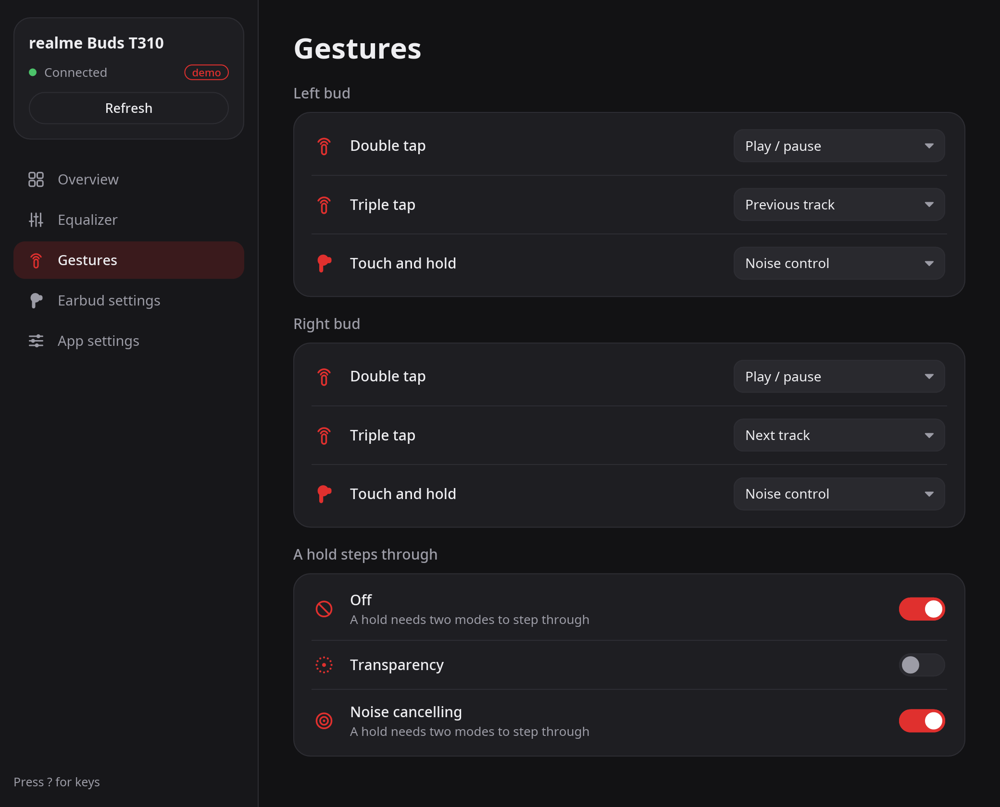
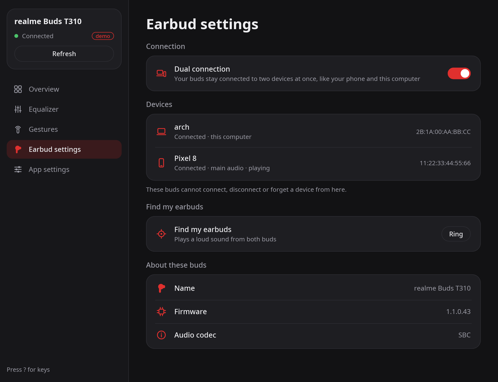
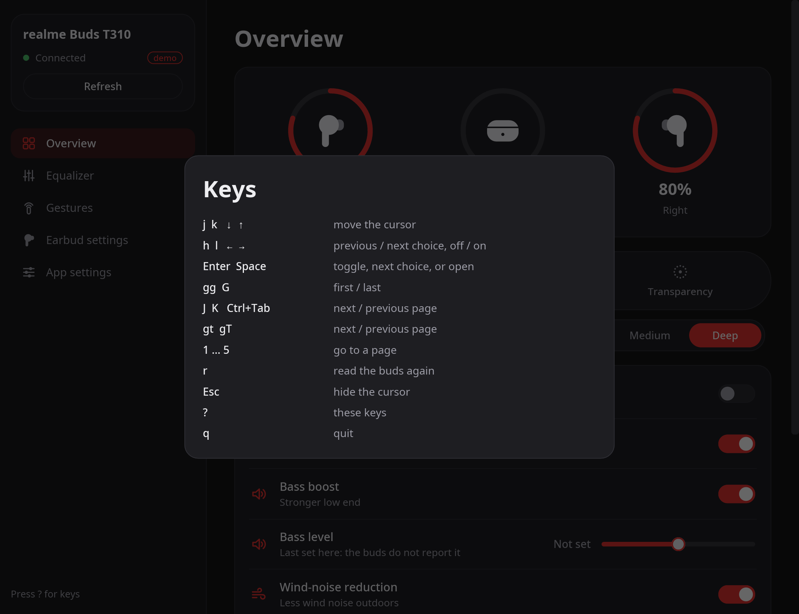

# budctl

Control your wireless earbuds from Linux, without the vendor app: noise control, EQ, game mode,
touch controls, battery and more. There is a command-line tool, `budctl`, and a desktop app,
`budctl-gui`, both built on the same library.

- No telemetry and no account. budctl talks to your buds over Bluetooth, through BlueZ.
- The settings live on the buds, so budctl works alongside the phone app.

**Supported buds:** realme Buds T310. More are added as the author gets them.

<p align="center">
  
</p>

## Install

You need Rust 1.88 or newer, BlueZ, and for the desktop app a Wayland desktop.

```sh
cargo install --path crates/budctl-cli    # budctl
cargo install --path crates/budctl-gui    # budctl-gui
cp contrib/budctl.desktop ~/.local/share/applications/
```

Pair the buds and connect them in your Bluetooth settings first.

## Command line

```sh
budctl list                                # paired buds, and whether budctl knows them
budctl status                              # battery, noise control, EQ, switches
budctl anc off|on|transparency             # noise control
budctl anc light|medium|deep               # noise cancelling, at this strength
budctl eq                                  # the EQ presets, and the one in use
budctl eq deep-bass                        # select a preset
budctl eq custom-4 50=+3 16000=-2          # change bands of a custom preset (dB)
budctl eq new Gym                          # create a custom preset: flat, and put to use
budctl eq rename custom-4 "Gym mix"        # rename a custom preset
budctl eq delete custom-4                  # delete a custom preset
budctl game on|off                         # game mode (low latency)
budctl set bass-boost|spatial|wind|dual on|off
budctl dual                                # the phones and computers dual connection keeps
budctl bass 2                              # bass level, -5 to +5
budctl touch                               # what each tap and hold does
budctl touch left triple-tap previous      # give a gesture an action (--dry-run first, if you like)
budctl touch cycle off anc                 # the modes a hold steps through
budctl find start --yes                    # ring the buds (loud: take them out of your ears)
budctl find stop
```

- `--json` prints machine-readable output for scripts and status bars (`"schema": 1`).
- `--debug` hex-dumps every frame sent and received, on stderr.
- `--device <MAC>` picks the buds when more than one supported pair is connected.

Exit codes:

| Code | Meaning |
|---|---|
| 0 | success |
| 1 | usage error |
| 2 | buds not found or not connected |
| 3 | control channel busy |
| 4 | the buds rejected the command or did not answer |

## Desktop app

`budctl-gui` has five pages:

- **Overview:** battery, noise control and its strength, the switches, the bass level.
- **Equalizer:** the presets; create, rename and delete your own, and change their bands.
- **Gestures:** what each tap and hold does on each bud, and what a hold steps through.
- **Earbud settings:** dual connection and the devices it keeps, find my earbuds, firmware, audio codec.
- **App settings:** where the colors come from, the keys, the version.

<table>
  <tr>
    <td valign="top"></td>
    <td valign="top"></td>
  </tr>
  <tr>
    <td valign="top"></td>
    <td valign="top"></td>
  </tr>
</table>

The screenshots show `--demo`'s made-up buds.

The app connects when it needs to, and frees the buds' control channel 10 s after your last
change, so other apps can use it. A change shows "Saving…" until the buds confirm it.

The mouse works everywhere. Vim-like keys work on top of it (press `?` in the window):

| Keys | What they do |
|---|---|
| `j` `k`, arrows, Tab | move the cursor |
| `gg` `G` | first / last item |
| `h` `l` | previous / next choice, switch off / on; `l` opens a row's page |
| Enter, Space | toggle, step through the choices, or open |
| `J` `K`, Ctrl+Tab, `gt` `gT` | next / previous page |
| `1` … `5` | go to a page |
| `r` | read the buds again |
| Esc | hide the cursor |
| `q` | quit |

The cursor shows only after you press a key, and the first key only shows it.

**Colors:** a built-in dark palette with a red accent, or a [matugen](https://github.com/InioX/matugen)
palette: `--theme <file>`, else `~/.config/budctl/theme.json`. The file is JSON with these keys, all
optional: `bg`, `fg`, `primary`, `primaryFg`, `primaryContainer`, `secondary`, `surfaceLow`,
`surface`, `surfaceHigh`, `surfaceHighest`, `outlineVariant`, `surfaceVariantFg`, `err`. It is read
again whenever the window gets focus, so a new wallpaper's colors show up there too.

Other options: `--demo` shows made-up buds without Bluetooth; `--debug` and `--device` work as in
the command-line tool.

## How it works

budctl speaks the buds' own control protocol over an RFCOMM socket. What is known about it, and
how sure, is written down in [`docs/protocol/`](docs/protocol/): the
[transport](docs/protocol/transport.md) and the [realme Buds T310](docs/protocol/realme_t310.md).

## License

GPL-3.0-or-later. See [LICENSE](LICENSE).
